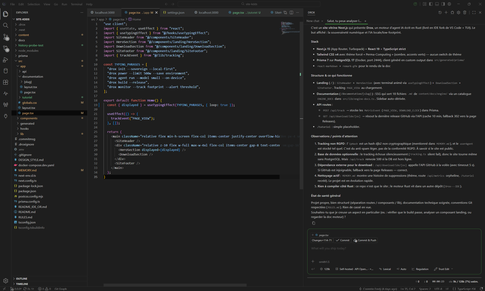
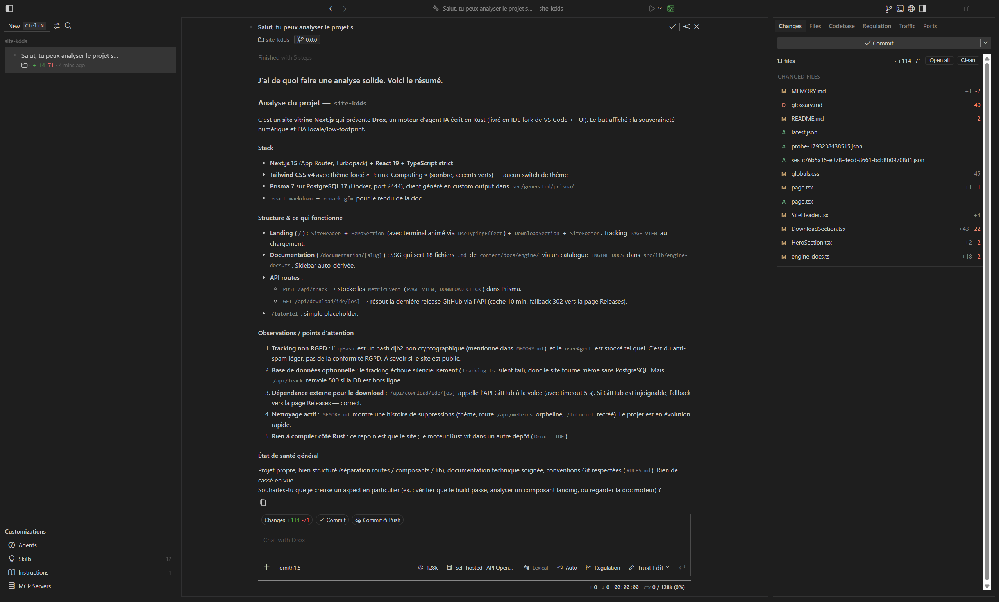
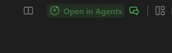
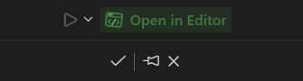
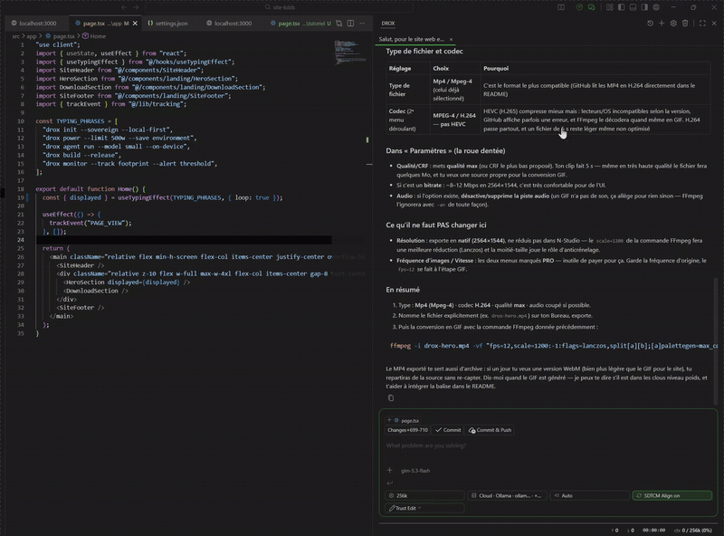
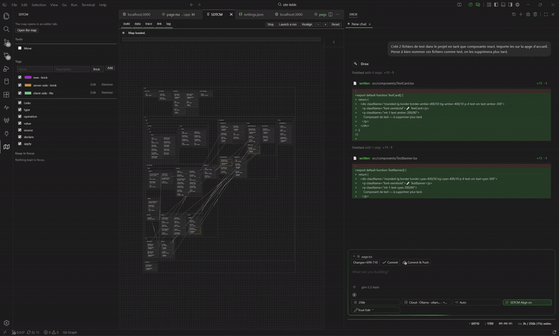
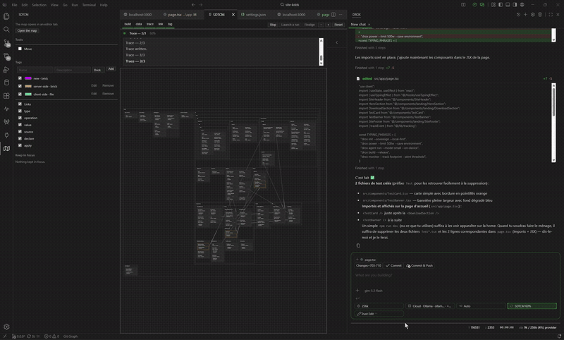

<p align="center">
  
</p>

# Drox IDE

Éditeur de code avec un agent IA **open source**. Version stable **1.6.8**. Il reprend [Visual Studio Code – Open Source (Code OSS)](https://github.com/microsoft/vscode) : extensions, terminal, Git, LSP — et y ajoute un moteur agent en Rust qui tourne **chez toi**.

Installeurs Windows et Linux : [**télécharger la 1.6.8**](https://github.com/DroxKiwi/Drox---IDE/releases/latest).

La même installation en ligne de commande. Le script prend la release marquée Latest et remplace une installation déjà présente.

Windows (PowerShell) :

```powershell
irm https://raw.githubusercontent.com/DroxKiwi/Drox---IDE/main/scripts/install/install.ps1 | iex
```

Linux :

```bash
curl -fsSL https://raw.githubusercontent.com/DroxKiwi/Drox---IDE/main/scripts/install/install.sh | bash
```

Drox IDE est référencé sur la page contributeur du [XERJ Corpus Hub](https://hub.xerj.org/contributors/DroxKiwi).

## L’IDE

Le chat Drox est dans la fenêtre de code : explorateur, éditeur, terminal, et la discussion à droite.

<p align="center">
  
</p>

## Le mode Agent

La même discussion en plein écran : sessions à gauche, réponse au centre, panneaux à droite.

<p align="center">
  
</p>

Dans le header, un bouton passe d’une fenêtre à l’autre. Le dossier ouvert ne change pas.

<p align="center">
  
</p>

**Open in Agents**, dans l’IDE, ouvre la fenêtre Agents.

<p align="center">
  
</p>

**Open in Editor**, dans Agents, revient à l’éditeur.

Le même header porte une icône livre. Elle lance le tutoriel de la fenêtre en cours : le tour IDE, ou le tour Agents.

<p align="center">
  
</p>

## SDTCM

SDTCM (*Simulator Data Transition into Code Map*) donne une carte du projet, lisible quel que soit le langage. Le modèle ne reçoit pas une grammaire par langage. Il range chaque nom dans quatre sortes et deux formes. Une sorte : `type` (classe, struct, enum, table SQL), `operation` (fonction, méthode, macro), `value` (constante, variable, colonne), `source` (import, `#include`, `using`). Une forme : `declare` pour la ligne qui introduit le nom, `apply` pour la ligne qui l’appelle ou le lit. Une `class` Python, une `struct` C++ et un `CREATE TABLE` deviennent ainsi la même brique. Un clic ouvre la ligne.

Un passage interroge le modèle de discussion, fichier par fichier : construction, données, trace, liens, puis tags. Chaque citation doit être la ligne réelle du fichier. **Realign** ne reprend que les fichiers dont le texte a bougé depuis la carte. Le résultat reste dans `.drox/sdtcm/`.

Dans le chat, la puce **SDTCM Align** active la mise à jour automatique. À la fin d’un run réussi, le modèle réaligne la carte. Cet appel consomme des tokens.

On demande une édition au modèle. Une fois **SDTCM Align** allumé, la carte se met à jour toute seule à la fin du run.

<p align="center">
  
</p>

Le modèle reporte ensuite ces changements sur la carte.

<p align="center">
  
</p>

## Codebase

**Codebase** sert à retrouver des extraits du dossier ouvert et à les glisser dans le contexte du run, sans que le modèle relise tout le projet. L’index est local, sous `.drox/codebase-index/`, et suit le dossier de la discussion, dans l’IDE comme dans Agents.

La recherche mêle le texte et des vecteurs. La vectorisation utilise un modèle d’embedding dédié, **all-MiniLM-L6-v2** en GGUF Q4 (environ 20 Mo, 384 dimensions). Ce n’est pas le modèle de discussion. On peut le remplacer par un autre GGUF d’embedding (`drox.codebase.embedModelPath`) ; le cockpit Codebase remet le modèle par défaut. On peut aussi couper les vecteurs et ne garder que la recherche textuelle. La puce **Auto** force l’index dans le prochain message quand il est prêt. Détail : [Codebase et RAG](docs/engine/codebase-and-rag.md).

## Régulation

**Regulation** sert à ajuster ce qu’on expose au modèle après un run, sans changer le modèle ni ses permissions. Cinq leviers : budget de contexte, surface d’outils, densité des consignes, strictesse du protocole, posture de recherche. Chaque run part de 100 et perd des points là où le moteur a stressé (boucle, format, annulation). La note est dans le panneau, dans l’IDE et dans Agents.

**Auto**, par levier, peut resserrer le module suivant quand la note baisse. Un choix manuel fige ce levier jusqu’au retour sur Auto. Détail : [régulation](docs/engine/model-regulation.md).

## Traffic

**Traffic** sert à voir où partent les appels de Drox : modèle, embeddings, MCP, outils, RPC. Chaque ligne porte le sens, la destination et si l’appel a abouti. La capture se coupe, reste en mémoire le temps de la fenêtre, ou s’écrit sur disque. On marque un hôte d’une couleur et d’un libellé, et on peut être prévenu quand un appel part vers lui.

## Ports

**Ports** sert à suivre un tunnel ouvert par un outil, ssh ou socat par exemple, et à dire quoi faire quand il est prêt. Chaque transfert porte l’hôte et le port distants, l’hôte et le port locaux, et le protocole (HTTP, HTTPS ou TCP). À l’ouverture : rien, une notification, la prévisualisation, ou le navigateur.

## En usage

- **Aucune télémétrie** Drox / KDDS.
- **Aucun cloud imposé** pour l’agent. Tu branches [Ollama](https://ollama.com/) en local, un provider du catalogue (Mistral, vLLM, LM Studio, Hugging Face, Scaleway, OVH, …) ou n’importe quel serveur **OpenAI-compatible**. URL et clés sont les tiennes. Détail : [llm-backends](docs/engine/llm-backends.md).
- Session, transcripts et réglages **sur ta machine** (`%APPDATA%\.drox-ide`, workspace).

| | |
|---|---|
| **Licence** | MIT — Code OSS (Microsoft) + portions Drox / KDDS — [`NOTICE.md`](NOTICE.md) |
| **Version** | **1.6.8** stable · base VS Code **1.127.0** |
| **Binaires** | [Releases](https://github.com/DroxKiwi/Drox---IDE/releases) — Windows et Linux |
| **Doc moteur** | [`docs/engine/`](docs/engine/README.md) |
| **Référencement** | [XERJ Corpus Hub — DroxKiwi](https://hub.xerj.org/contributors/DroxKiwi) |

---

## Documentation

- [Hub](docs/README.md)
- [Moteur](docs/engine/README.md)
- [Pédagogie](docs/pedagogie/README.md)
- [Navigation IDE](docs/tutorials/ide-navigation.md)
- [Release](docs/release/README.md)
- [Ligne 1.6](docs/1.6/README.md)

---

## Remerciements

Merci au **SI de [Salesky](https://www.salesky.fr/)** pour les tests et le matériel.

---

## Licence

MIT. Code OSS © Microsoft ; portions Drox / KDDS © KDDS — [`NOTICE.md`](NOTICE.md) · [`LICENSE.txt`](LICENSE.txt).
