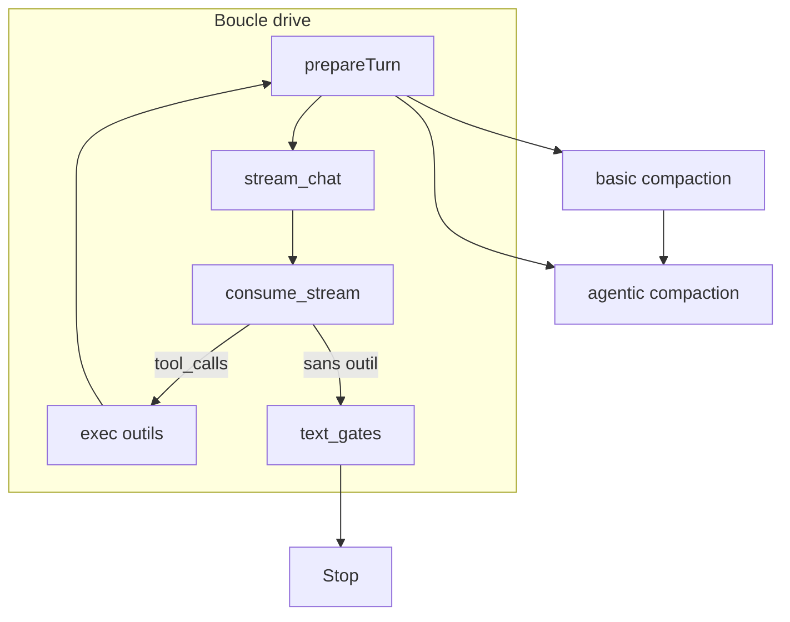

# 05 — Plan de transformation moteur (étapes Cline-like)

Document de référence pour la transformation du moteur Drox alignée sur le verdict produit (novembre 2026). Il complète [`03-axes-dimplementation.md`](03-axes-dimplementation.md) et [`04-mecanismes-a-etudier.md`](04-mecanismes-a-etudier.md) avec un **cadrage d’exécution** : lots, fichiers, dépendances, critères GO.

**Principe** : inspiration **conceptuelle** Cline — pas de port TypeScript dans le Rust Drox (cf. [`README.md`](README.md)).

---

## 1. Verdict produit (in / out)

### Inclus

| Capacité | Référence Cline | Priorité |
|----------|-----------------|----------|
| Clôture sur tour sans outil | `agent-runtime` : `toolCalls.length === 0` → fin | P0 |
| `prepareTurn` + compaction (déterministe + LLM, ancrage provider) | A1–A2 doc 04 | P0 |
| Notices typées transcript | B4 `status-notice` | P1 |
| Args outils tolérants | A4 `normalizeJsonLikeStringsForSchema` | P1 |
| Checkpoints workspace (restore fichiers) | B1 shadow-git | P1 (XL) |

### Exclus (cette vague)

- Outil terminal obligatoire `complete_run` / `submit_and_exit` (Axe B doc 03 — optionnel plus tard).
- Hooks unifiés Cline (A5).
- Mentions `@file` (B3), teams (C2), cron (C4).
- Copie littérale du code Cline.

### À préserver

- [`loop_detect/`](../../drox-engine/drox/crates/drox-engine/src/agent/loop_detect/) — anti-boucle *avec* outils.
- Explore child : branche `explore_execution` dans `text_gates.rs`.
- `rewrite_transcript_after_shrink` après shrink contexte (transcript JSONL).

---

## 2. Glossaire

| Terme Drox (actuel / cible) | Signification |
|-----------------------------|---------------|
| **Checkpoint contexte** | Message `system` injecté par [`format_compact_checkpoint`](../../drox-engine/drox/crates/drox-engine/src/compaction/live.rs) après compaction LLM — **historique modèle** uniquement. |
| **Checkpoint workspace** | Snapshot disque du workspace (fichiers) corrélé à un tour / message utilisateur — **réversibilité agent**. |
| **prepareTurn** | Pass unique avant chaque `stream_chat` : budget, snip, basic/agentic compaction, injections situation card. |
| **Clôture moteur** | `engine_closure` : profil parent, tour sans `tool_calls` → `Stop` sans négociation de phase. |

---

## 3. Cartographie actuelle

| Zone | Rôle aujourd’hui | Écart Cline |
|------|------------------|-------------|
| [`drive/pre_turn.rs`](../../drox-engine/drox/crates/drox-engine/src/agent/run/drive/pre_turn.rs) | `maybe_snip` + situation card + nudges itération | Pas de module `prepare_turn` nommé ; compaction couplée à `memory` |
| [`drive/text_gates.rs`](../../drox-engine/drox/crates/drox-engine/src/agent/run/drive/text_gates.rs) | Gate 3 sauf `[phase: acting]` ; FX-B ; todos → nudge | Fin dépend du texte / phase |
| [`compaction/live.rs`](../../drox-engine/drox/crates/drox-engine/src/compaction/live.rs) | LLM summarize ; échec = pas de shrink | Pas de `basic-compaction` filet |
| [`event.rs`](../../drox-engine/drox/crates/drox-engine/src/event.rs) | `ContextCompacted`, pas de notice générique | Pas de `status_notice` |
| [`drox-tools`](../../drox-engine/drox/crates/drox-tools/) | `serde_json::from_value` strict | Rejets fréquents local-9b |
| IDE [`droxChatAgentEvents.ts`](../../src/vs/workbench/contrib/drox/browser/droxChatAgentEvents.ts) | `context_compacted` → ligne system | Pas de kinds notices |
| IDE checkpoints | Absent | B1 |

---

## 4. Architecture cible

---

## 5. Lots d’implémentation

### Lot 1 — Clôture sans outil (P0)

**Objectif** : `engine_closure && tool_calls.is_empty()` ⇒ `Stop` (y compris `[phase: acting]`).

| Composant | Fichiers | Changement |
|-----------|----------|------------|
| Gates | `text_gates.rs` | Gate 3 sans exception `Acting` ; supprimer FX-B ; todos ouvertes → notice (Lot 3) ; pseudo-XML hors fence → livrer + notice |
| Clôture UI texte | `engine_closure.rs` | Une émission (`reply_already_visible`) |
| Anti-boucle | `loop_detect/` usage dans text_gates | Retirer `loop_detector.reset()` sur nudges phase |
| Prompts | `drox-prompts/local.rs` | `reply_has_textual_tool_call_outside_fences` |
| Tests | `agent/tests/closure_tests.rs` | Matrice F1–F2 doc 03 |
| Doc | `docs/engine/agent-run-loop.md` | § Clôture |

**GO** : reproducteur doc 02 §5 — un tour, un `Stop`, zéro `INTENT_ONLY_WRITE_*`.

---

### Lot 2 — prepareTurn + compaction (P0)

**Objectif** : runs longs — filet déterministe puis LLM ; plancher tokens provider.

| Composant | Fichiers | Changement |
|-----------|----------|------------|
| Module | `agent/prepare_turn/mod.rs` | API `effective_context_tokens`, orchestration shrink |
| Basic | `compaction/basic.rs` | Troncature déterministe sans LLM |
| Live | `compaction/live.rs`, `lifecycle.rs` | Basic avant agentic ; basic si summarize échoue ; basic si `memory` absent |
| État | `drive/state.rs`, `llm_turn.rs` | `last_turn_input_tokens` |
| Policy | `context_policy.rs` | `effective_token_count(estimate, provider_floor)` |
| LLM | `drox-llm/error.rs` | `is_context_length_exceeded()` pour retry + basic |

**Paramètres cibles** (échelle fenêtre effective) :

- Trigger compaction : ~0,9 × fenêtre effective.
- Cible post-compact : ~0,7 × fenêtre.
- `MAX_INPUT_UNDERESTIMATE_FACTOR` : 4 (plancher provider / estimateur).
- Réserve tail récente : proportionnelle à Cline (~20k tokens sur grandes fenêtres).

**GO** : historique synthétique > seuil → `ContextSnip` ou basic compact sans crash ; mock summarize fail → basic appliqué.

---

### Lot 3 — Notices typées (P1)

**Objectif** : visibilité transcript (compaction, todos, imitation outil).

| Composant | Fichiers | Changement |
|-----------|----------|------------|
| RPC | `event.rs` | `StatusNotice { kind, level, message, detail? }` |
| Moteur | `agent/status_notice.rs` | Helper `emit_status_notice` |
| IDE | `droxChatAgentEvents.ts` | `case 'status_notice'` → `append` role system stylé |
| TUI | `drox-tui` event loop | Rendu notice dans message log |

**Kinds stables** : `context_overflow_recovery`, `open_todos_at_close`, `textual_tool_imitation`, `compaction_failed_fallback_basic`, `closure_mechanical`.

---

### Lot 4 — Args outils tolérants (P1)

**Objectif** : coercion JSON-like avant `serde`.

| Composant | Fichiers | Changement |
|-----------|----------|------------|
| Coercion | `drox-tools/normalize_json_like.rs` | Récursion string → bool/number/json |
| Entrée unique | `registry.rs` `execute_named` | `normalize_json_like_strings(input)` |
| Tests | `normalize_json_like` tests | `"true"`, `"42"`, objets imbriqués |

---

### Lot 5 — Checkpoints workspace (P1, XL)

**Objectif** : snapshot local-first + restore par tour.

| Phase | Composant | Livrable |
|-------|-----------|----------|
| 1 | `DroxWorkspaceCheckpointService.ts` | Interface + stockage `.drox/checkpoints/` (manifest JSON) |
| 1 | Enregistrement singleton | `droxCoreSingletons.ts` |
| 2 | UI transcript | Bouton restore (fil Drox agents) |
| 2 | Moteur (optionnel) | `AgentEvent::WorkspaceCheckpoint { id, message_index }` avant batch mutateur |

**Ne pas confondre** avec checkpoint contexte compaction.

---

## 6. Matrice d’impact

| Lot | drox-engine | drox-tools | drox-llm | drox-prompts | IDE | RPC |
|-----|-------------|------------|----------|--------------|-----|-----|
| 1 | ●●● | — | — | ● | ○ | — |
| 2 | ●●● | — | ● | — | ○ | — |
| 3 | ●● | — | — | — | ●● | ● |
| 4 | ○ | ●● | — | — | — | — |
| 5 | ○ | — | — | — | ●●● | ● (phase 2) |

Légende : ● fort ; ○ léger / absent.

---

## 7. Ordre et jalons version

| Jalon | Lot | Livrable utilisateur |
|-------|-----|----------------------|
| **2.0.2-moteur** | 1 | Runs qui se ferment sans re-stream FX-B |
| **2.0.3-moteur** | 2 + 3 | Long runs + transcript lisible |
| **2.0.4-moteur** | 4 | Moins d’échecs tools local-9b |
| **2.0.x** | 5 | Restore workspace depuis le chat |

Eval minimal (doc 04 C1) : recommandé avec Lot 1 (`closure_tests`).

---

## 8. Validation

1. `cargo test -p drox-engine` (incl. `closure_tests`, compaction basic).
2. `cargo test -p drox-tools` (normalize).
3. `.\scripts\package-drox.ps1 -Profile debug` après changements moteur.
4. Dogfood : run long > autocompact ; run `[phase: acting]` sans outil ; tool args `"true"`.

---

## 9. Diagnostics compaction (état avant Lot 2)

1. Échec `summarize_run` → historique inchangé (crash contexte suivant).
2. Sans `memory` → pas de compact LLM malgré seuil dépassé.
3. Estimateur char-based seul — pas de plancher `TurnUsage`.
4. Pas de retry unifié overflow API + basic.

Ces points sont adressés par le Lot 2.

---

## 10. Références

- Clone étude Cline : `4cdfb19` (cf. doc 04).
- Symptômes : [`02-drox-run-gaps.md`](02-drox-run-gaps.md).
- Boucle actuelle : [`docs/engine/agent-run-loop.md`](../engine/agent-run-loop.md).